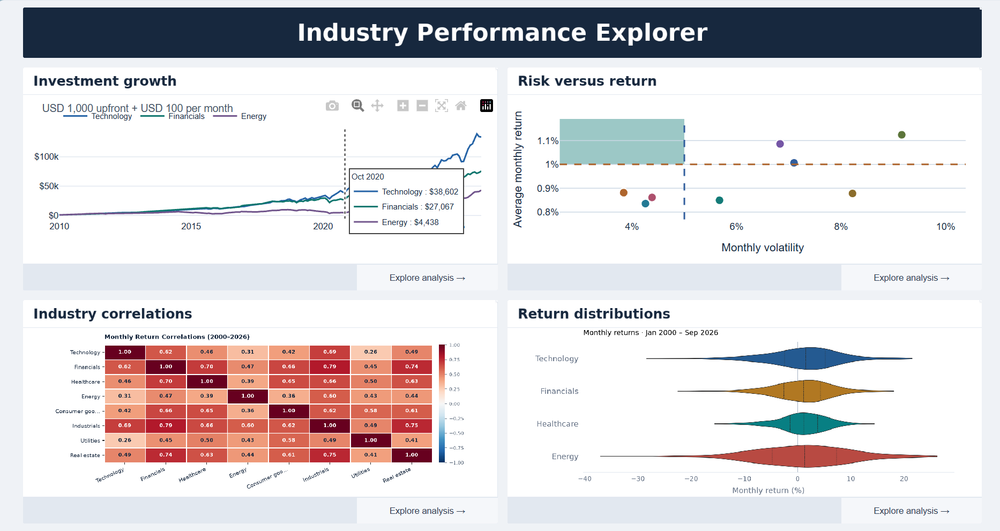

# Industry Performance Explorer

A Python dashboard exploring historical returns across eight sector groups: Technology, Financials, Healthcare, Energy, Consumer goods, Industrials, Utilities and Real estate.

The dashboard asks: **How have sectors performed, what risks accompanied those returns, and how closely did they move together?**

Four analyses address different parts of this question:

| Panel | Purpose |
|---|---|
| Investment growth | Explore how historical returns and regular contributions affected investment value. |
| Risk versus return | Compare average returns with volatility and downside deviation. |
| Industry correlations | Examine how closely sectors moved together over the selected period. |
| Return distributions | Compare typical returns, their spread and historical downside outcomes. |

The overview displays a preview of each analysis. Select **Explore analysis** to open its detailed charts and controls.

Results describe the selected historical sample and should not be interpreted as forecasts or investment recommendations.



## Contents

- [Installation and running](#installation-and-running)
- [Data source and preparation](#data-source-and-preparation)
- [Project files](#project-files)
- [Investment Growth Panel](#investment-growth-panel)
- [Risk vs Return Panel](#risk-vs-return-panel)
- [Industry Correlations Panel](#industry-correlations-panel)
- [Return Distributions Panel](#return-distributions-panel)
- [Team contributions](#team-contributions)
- [Overall limitations](#overall-limitations)

## Installation and running

The dashboard was developed using Python 3.14.7. Package versions are listed in `requirements.txt`.

### 1. Download the project

Clone this repository or download and extract its ZIP file. Open a terminal in the project folder containing `python.py`, `requirements.txt` and `industry_returns_clean.csv`.

Keep the supplied panel files and resources in their original locations.

### 2. Create a virtual environment

On Windows:

```powershell
py -m venv .venv
```

### 3. Install the dependencies

```powershell
.\.venv\Scripts\python.exe -m pip install -r requirements.txt
```

### 4. Start the dashboard

```powershell
.\.venv\Scripts\python.exe python.py
```

Open the local URL printed in the terminal if the browser does not open automatically. Keep the terminal running while using the dashboard. Press Ctrl+C to stop it.

### macOS and Linux

Use these commands from the project folder:

```bash
python3 -m venv .venv
.venv/bin/python -m pip install -r requirements.txt
.venv/bin/python python.py
```

Use Python 3.14.7 to match the development environment. Other Python versions have not been verified.

The supplied cleaned CSV allows the dashboard to run without regenerating the dataset.

## Data source and preparation

The dashboard uses daily industry portfolio returns from the [Kenneth French Data Library](https://mba.tuck.dartmouth.edu/pages/faculty/ken.french/data_library.html), supplied in `49_Industry_Portfolios_Daily.csv`.

The cleaned dataset, `industry_returns_clean.csv`, contains 6,726 daily observations from **3 January 2000 to 30 September 2026**, with eight custom sector groups.

### Sector definitions

| Sector group | Source industry columns |
|---|---|
| Technology | Softw, Hardw, Chips |
| Financials | Banks, Insur, Fin |
| Healthcare | Hlth, MedEq, Drugs |
| Energy | Oil, Coal |
| Consumer goods | Food, Soda, Beer, Smoke, Hshld, Clths |
| Industrials | Mach, ElcEq, Steel, FabPr, Aero, Ships |
| Utilities | Util |
| Real estate | RlEst |

These are project-defined groups rather than an official sector classification.

### Cleaning process

`clean_data.py`:

1. Extracts the **Average Value Weighted Returns** section of the original file.
2. Cleans column headings, parses dates and retains the required industries.
3. Converts return columns to numeric values and replaces missing-value codes `-99.99` and `-999` with `NaN`.
4. Retains available observations from 2000 through 2026, sorts dates and checks for duplicates.
5. Divides percentage returns by 100, so `0.01` represents a 1% return.
6. Calculates each custom sector’s daily return as the arithmetic mean of its constituent industry returns.
7. Saves the result as `industry_returns_clean.csv`.

The source industry portfolios are **value-weighted within each industry**. However, the constituent industry returns receive **equal weights when combined into our custom sector groups**. The resulting groups should therefore not be interpreted as fully market-cap-weighted sector portfolios.

If any constituent industry return is missing on a date, the corresponding sector return remains missing. Missing returns are not replaced with zero. Each panel’s treatment of missing observations and aggregated periods is described in its own section.

### Regenerating the dataset

The supplied cleaned CSV can be used directly. To regenerate it, place the original file beside `clean_data.py` and run this command from the project folder:

```powershell
.\.venv\Scripts\python.exe clean_data.py
```

The script creates:

- `value_weighted_returns.csv` — the extracted source table.
- `industry_returns_clean.csv` — the eight-sector dataset used by the dashboard.

Using a newer source file may change the available observations and results. The reproducible examples in this README refer to the supplied cleaned dataset.

## Project files

| File | Purpose |
|---|---|
| `python.py` | Main dashboard connecting the four previews and detailed panels. |
| `investment_growth_graph.py` | Investment growth calculations and interface. |
| `risk_vs_return.py` | Risk-versus-return analysis and interface. |
| `correlation_graph.py` | Correlation analysis and interface. |
| `return_dist_graph.py` | Return distributions, downside measures and interface. |
| `industry_returns_clean.csv` | Cleaned daily sector returns used by all panels. |
| `clean_data.py` | Extracts and cleans the source data and creates the sector groups. |
| `49_Industry_Portfolios_Daily.csv` | Original source data required to regenerate the cleaned dataset. |
| `value_weighted_returns.csv` | Intermediate table generated by the cleaning script. |
| `requirements.txt` | Required Python packages and recorded versions. |
| `README.md` | Project description, setup instructions and panel documentation. |
| `.gitignore` | Excludes generated files and the local virtual environment from Git. |
| `images/dashboard.png` | Dashboard screenshot displayed in this README. |
| (`investment_growth.py` — check before submission) | Potentially wrong confirm with before removing. |


The dashboard runs using the supplied cleaned dataset. The original source file and cleaning script are needed only to regenerate it.

## Investment Growth Panel

This panel uses historical industry returns to show how the same investment would have grown in different industries. You can change the industries, date range, starting investment, monthly contribution, and investment goal.

### Reproduce a result

Use these settings to check that the chart and comparison table agree:

1. Select Technology, Financials, and Energy.
2. Set the years to 2010–2025, the starting investment to USD 1,000, and the monthly contribution to USD 100.
3. Set the investment goal to USD 50,000.

With all 192 months from January 2010 to December 2025 included, the Money paid in line should finish at USD 20,200 for each industry (`1,000 + 192 × 100`). The table ranks the selected industries by ending value. Each industry's gain or loss equals its ending value minus USD 20,200. The goal column shows the first month its balance reached USD 50,000, if it reached that amount.

For a second check, set the monthly contribution to USD 0. The Money paid in line should stay flat at **USD 1,000**, while the industry lines still move with historical returns.

### How the calculation works

The panel compounds daily returns into calendar-month returns. It plots the starting investment before the first month's return, then applies this calculation each month:

```text
New balance = previous balance × (1 + monthly return) + monthly contribution
```

Contributions are added at the end of each month, so each contribution starts earning returns the following month. The chart replays historical returns and excludes fees, taxes, and inflation.

### Data and input requirements

The panel uses the supplied `industry_returns_clean.csv`. You can run it with that file as provided. If you need to regenerate the dataset, run `python clean_data.py` from the project folder.

The CSV needs a `Date` column and one column of daily returns per industry. Returns are stored as decimals, so `0.01` represents 1%. The panel requires monthly returns for every selected industry throughout the chosen date range.

Select at least one industry, enter a start year no later than the end year, and use non-negative amounts. The panel starts with Technology, Financials, and Energy when those columns are available. It uses the portion of 2010–2025 covered by the dataset.

### Dashboard integration

[`investment_growth_graph.py`](./investment_growth_graph.py) provides `make_growth_preview()` for the dashboard overview and `build_growth_panel(app)` for the Explore view. The underlying `build_panel(csv_path)` function builds the interactive controls, chart, and comparison table.


## Risk vs Return Panel

This panel uses historical industry returns to compare how much each industry earned on average and how much its returns varied. You can change the industries, date range, return frequency, risk measure, and targets. Each point represents one industry, with risk on the horizontal axis and average return on the vertical axis.

### Reproduce a result

Use these settings to check that the chart, target summary, and industry statistics table agree:

1. Select all eight industries and use the full date range in the supplied dataset.
2. Set the frequency to **Annual** and the risk measure to **Volatility**.
3. Set the minimum return to **10%** and the maximum volatility to **20%**.

The summary should show **3 of 8 industries meet both targets**. Consumer goods, Healthcare, and Utilities should appear in the shaded area. Each had an average annual return of at least 10% and annual volatility of at most 20%.

For a second check, raise the maximum volatility to **21%**. Financials should now qualify, bringing the count to **4 of 8**. Its volatility is about 20.68%, so the new threshold includes it while the figures in the table stay the same.

### How the calculation works

The panel uses daily returns directly for Daily frequency. For Weekly, Monthly, or Annual frequency, it compounds the daily returns within each period:

~~~text
Period return = product of (1 + each daily return) − 1
~~~

It then calculates the arithmetic mean of the period returns and one of two risk measures:

- **Volatility** is the sample standard deviation of the period returns.
- **Downside deviation** is the square root of the average squared negative return, counting zero and positive returns as zero in that average.

The chart and table display the results as percentages. The targets use the selected frequency, so a 1% return target in Monthly mode means an average monthly return of 1%. The maximum volatility target applies in Volatility mode.

### Data and input requirements

The panel uses the supplied `industry_returns_clean.csv`. You can run it with that file as provided. If you need to regenerate the dataset, run `python clean_data.py` from the project folder.

The CSV needs a `Date` column and one column of daily returns per industry. Returns are stored as decimals, so `0.01` represents 1%. An industry needs at least two usable period returns to appear in the chart and table.

Select at least one industry, choose a start date no later than the end date, and use a non-negative maximum volatility. The panel starts with all industries selected, the full available date range, Monthly frequency, a 1% minimum return, and a 5% maximum volatility.

### Dashboard integration

[`risk_vs_return.py`](./risk_vs_return.py) provides `make_risk_preview()` for the dashboard overview and `build_risk_panel(app)` for the Explore view. The underlying `risk_vs_return_panel(returns)` function builds the interactive controls, chart, target summary, and industry statistics table.


## Industry Correlations Panel

This panel uses historical industry returns to show how closely different industries move together over time and where portfolio diversification opportunities exist. You can change the industries, date range, return frequency, correlation method, minimum correlation threshold, statistical significance filter, value labels, and matrix layout. Each cell compares two industries, with colour and numeric values showing the direction and strength of their relationship from -1.00 (opposite movement) to +1.00 (identical movement).

### Reproduce a result

Use these settings to check that the heatmap and diversification summary agree:

1. Select all eight industries and set the start year to 2000 and end year to 2026.
2. Set the frequency to Monthly and the method to Pearson.
3. Set the absolute correlation threshold `|r|` to 0.00, check **Show values**, leave **Significant only (p < 0.05)** unchecked, and set the matrix view to **Full Matrix**.

With all eight industries included over the full monthly sample, the summary below the chart should report an average cross-sector correlation of **0.55**, with **Financials & Industrials (0.79)** as the highest co-moving pair and **Technology & Utilities (0.26)** as the best diversification pair. Every diagonal cell should display **1.00**, and off-diagonal cells should match the overview preview card.

For a second check, raise the absolute correlation threshold `|r|` to **0.70**. Only pairs with a correlation magnitude of at least 0.70 (such as Financials & Industrials at 0.79, Financials & Real estate at 0.74, and Industrials & Real estate at 0.75) remain visible off the diagonal, while weaker relationships are hidden.

### How the calculation works

The panel uses daily returns directly for Daily frequency. For Weekly, Monthly, or Quarterly frequency, it compounds the daily returns within each period:

`Period return = product of (1 + each daily return) − 1`

It then computes pairwise correlations and two-tailed *p*-values across every pair of selected industries using the chosen method:

* **Pearson** measures linear co-movement between two return series.
* **Spearman** measures rank-order (monotonic) co-movement, making it less sensitive to extreme single-period market shocks.

Any pair with fewer than 3 overlapping return observations is excluded. When **Significant only (p < 0.05)** is checked, off-diagonal pairs whose two-tailed *p*-value is 0.05 or higher are hidden from the matrix. The summary sentence below the chart averages all unique off-diagonal pairs (`i < j`) and identifies the highest-correlating and lowest-correlating pairs.

### Data and input requirements

The panel uses the supplied `industry_returns_clean.csv`. You can run it with that file as provided. If you need to regenerate the dataset, run `python clean_data.py` from the project folder.

The CSV needs a `Date` column and one column of daily returns per industry. Returns are stored as decimals, so `0.01` represents 1%.

Select at least two industries to compute a correlation matrix. If the start year is entered after the end year, the panel automatically swaps the two bounds so a valid date window is always evaluated. The Explore panel starts with all industries selected, the full available year range, Daily frequency, Pearson method, a `0.00` threshold, value labels enabled, and Full Matrix view.

### Dashboard integration

`correlation_graph.py` provides `make_correlation_preview()` for the dashboard overview (returning a static Matplotlib heatmap rendered at 10 × 4 inches and 150 DPI) and `build_correlation_panel()` for the Explore view. The underlying `update_correlation_panel(...)` callback updates the interactive Plotly heatmap or 3D surface and the diversification summary whenever any control changes.

## Return Distributions Panel

This panel compares the shape, spread and downside of historical sector returns. Users can choose sectors, dates, Daily or Monthly returns, and five chart types: Histogram, Box plot, Violin plot, Cumulative probability and Normal Q-Q.

Charts update automatically and support hovering and zooming. Key findings highlights differences between the selected sectors, while Compare exact values provides the corresponding statistics.

### Reproduce a result

1. Select Technology, Financials, Healthcare and Energy.
2. Set From to `03/01/2000` and To to `30/09/2026`.
3. Select Monthly returns and Histogram.
4. In Risk, set the loss threshold to `-4%` and confidence to `95%`.

These settings produce 320 monthly observations per sector, covering February 2000 to September 2026. January is excluded because the selected start date is after the first calendar day of that month.

The findings should report:

- Energy has the widest middle-50% range: **12.01 percentage points**. Healthcare has the narrowest: **5.15 percentage points**.
- Energy has the lowest historical tail mean: **−19.04%**, averaging returns at or below its lower 5% cutoff.
- Energy has the highest frequency of returns at or below −4%: **27.2%**.

Switch between Central 98% and Full range. The histogram view should change, while the findings and comparison statistics remain unchanged.

### How the calculations work

Daily mode uses the supplied daily simple returns. Monthly mode compounds them:

```text
Monthly return = product of (1 + each daily return) − 1
```

Only calendar months fully inside the selected dates are included. A sector-month containing a missing daily return is marked as missing. Both frequencies retain only dates with valid returns for every selected sector, ensuring a common comparison sample. Returns are converted from decimals to percentages for display.

The comparison table reports:

- **Median return:** the middle value.
- **Middle-50% range:** the 75th percentile minus the 25th percentile, in percentage points.
- **Loss frequency:** the percentage of returns at or below the chosen loss threshold.
- **Tail cutoff:** the lower sample quantile selected through confidence; 95% confidence uses the 5th percentile.
- **Tail mean:** the average return at or below that cutoff.

The chosen loss threshold is separate from the estimated tail cutoff. Statistics remain available when their reference lines are hidden.

### Charts and display settings

- **Histogram:** return density, with optional density curve, normal reference and historical-tail overlays.
- **Box plot:** median, quartiles and outliers.
- **Violin plot:** estimated distribution shape and quartiles.
- **Cumulative probability:** proportion of observations at or below each return.
- **Normal Q-Q:** visual comparison with a fitted normal reference, rather than a formal normality test.

Histograms use common bins and matching scales. Central 98% initially displays the pooled 1st–99th percentile range, expanding if needed to include an enabled loss-threshold line. Full range displays the extremes.

This window changes only the view: calculations still use the full selected sample. The expandable histogram section reports visible bounds and counts outside the view.

### Data and input requirements

Place `industry_returns_clean.csv` beside `return_dist_graph.py`. It must contain a `Date` column and numeric daily-return columns stored as decimals: `0.01` represents 1%.

Enter dates as `DD/MM/YYYY`; ISO dates are also accepted. Select at least one sector and a start date no later than the end date. The panel displays guidance for invalid selections or insufficient data.

The panel opens with four sectors, Monthly returns and Histogram. Risk and display options are grouped separately.

### Dashboard integration

`return_dist_graph.py` provides:

- `make_distribution_preview()` — static monthly violin preview.
- `build_distribution_panel(app)` — detailed Gradio interface and automatic updates.

The preview uses all available monthly data; the detailed panel applies its selected calendar-date boundaries. Samples can therefore differ at the dataset boundaries.

To run the panel separately:

```powershell
py return_dist_graph.py
```

### Limitations

Results describe historical observations, not forecasts or maximum possible losses. Density and tail estimates can be unstable in small samples. Adding a sector with missing observations can change the common sample used for all selected sectors.

## Team contributions

| Team member | Main responsibility | Additional contributions |
|---|---|---|
| Jack O’Sullivan | Return distributions panel | Data preparation, dashboard design and integration |
| George O'Toole | Investment growth panel | [Additional contributions] |
| Matthew Kearney | Risk versus return panel | [Additional contributions] |
| Conall Criostóir | Industry correlations panel | Read me documentation, end to end dashboard testing |

## Overall limitations

- Results describe historical data and are not forecasts.
- The eight sector groups are project-defined and equally weight their constituent industry portfolio returns.
- Results depend on the selected dates, return frequency and each panel’s missing-data rules.
- Historical correlations may change and do not guarantee diversification benefits.
- Investment growth excludes fees, taxes and inflation.
